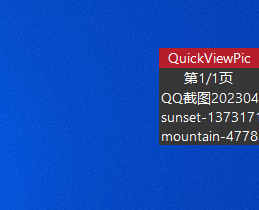
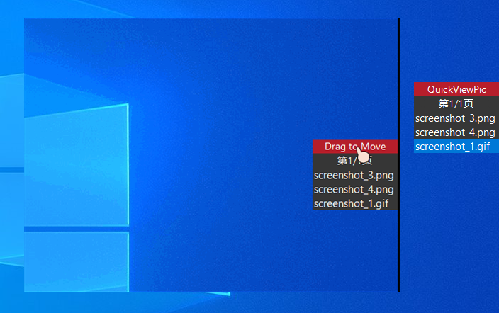
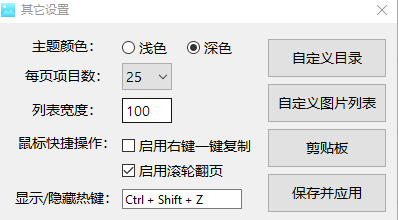
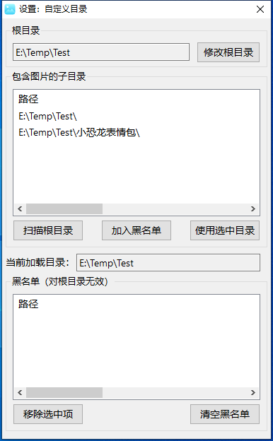
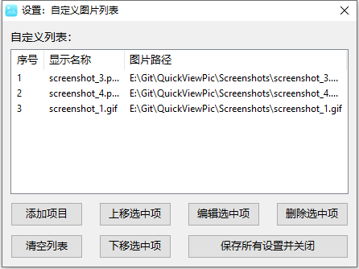
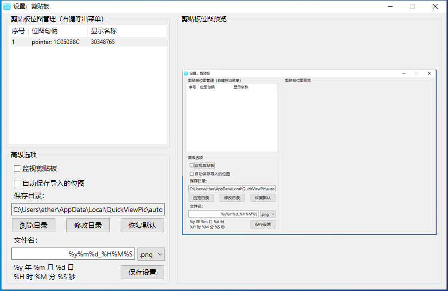
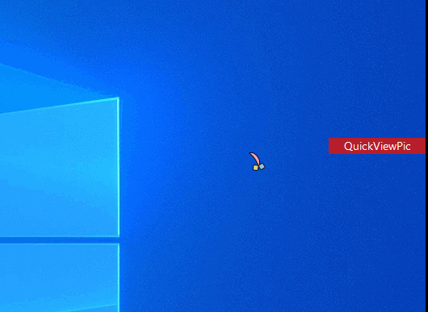
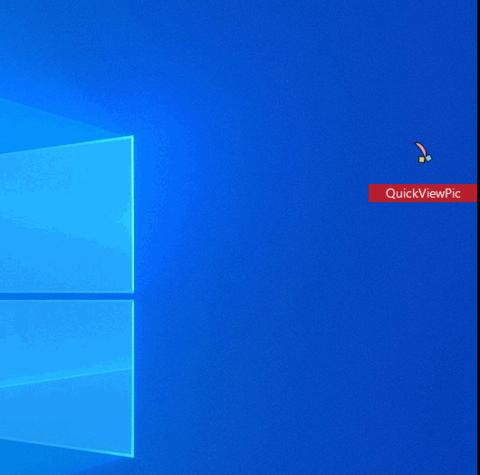

# QuickViewPic
A small tool to view images quickly.  
一个简单的快速看图小工具。

程序灵感来自[@hamoyy](https://meta.appinn.net/t/topic/38641)，全部使用[aardio](https://www.aardio.com)编写。  
单文件打包编译，体积仅约 1.5MB ，绿色便携。

作者邮箱：xenon2333@qq.com  
下载地址：[Release](https://github.com/xenon2333/QuickViewPic/releases)

## 使用场景
- 需要重复快速查看指定图片，如查询尺码表。
- 需要将多张截图“钉”在屏幕上，且要求快速来回切换。
- 快速浏览本地保存的表情包，并一键复制到剪贴板，用于聊天工具中。

## 基本介绍
启动程序后会显示一个**悬浮按钮**，将按钮**拖拽**至屏幕边缘会自动吸附，此时将鼠标移入按钮则会显示图片列表。  
最上方的按钮右键点击即可弹出菜单，可进行设置或退出操作。

在图片列表中，上下移动鼠标可选择项目，同时会在一旁自动显示图片。  
可设置每一页的项目数，并且支持滚轮翻页。  
支持右键点击列表项、一键复制当前选中项到剪贴板。  
左键双击列表项可将当前图片固定在屏幕上，不再自动隐藏。再次双击任意项（或者右键点击图片区域）解除固定。  
被固定的图片可被拖动到任意位置，但不支持缩放。（有缩放需求建议移步Pixpin的贴图功能）

设置将在程序退出时自动保存至`%LocalAppData%`目录下的`QuickViewPic\config.cfg`（剪贴板数据除外）。
> 若程序当前目录下存在`config.cfg`文件，则将其作为配置读取。（便携化）

## 模式
### 默认
自动从程序启动目录读取图片。  
支持的图片格式：**jpg**、**jpeg**、**png**、**bmp**、**gif**。（下同）

### 自定义目录
由用户指定图片根目录，程序会自动扫描含有图片的子目录并供用户选择。程序会从用户选择的目录读取图片。
### 自定义图片列表
由用户自行指定图片的路径及显示顺序。
### 剪贴板
从剪贴板中导入位图并显示。  
支持剪贴板监视及自动保存功能。

获取位图的方式包括但不限于：
- 截图工具
- 浏览器页面复制

可反复导入多张位图。

## 注意事项
- 尽量不要浏览太大的图片，可能会导致程序卡顿甚至崩溃。
- 图片像素大小超过屏幕大小时会自动缩小图片，会导致图片失真。
- 图片切换过程有闪烁感属于正常现象。
- 程序一旦退出，已缓存的剪贴板数据将会丢失！
- 程序支持多屏，但请不要在程序运行时改变屏幕设置！

## 截图
- 界面：

- 设置界面：

## 动图演示

## 其它要说的
这个程序是我第一个发到github上的作品（其实本人也之前写过几个，不过都是给自己用的），希望大家多多支持，帮我测试一下。另外本人并非计算机相关专业的学生，敲代码纯属个人喜好，程序难免会有不足之处，恳请各位指正。
